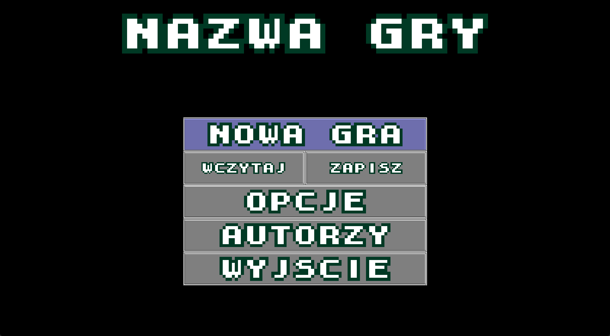
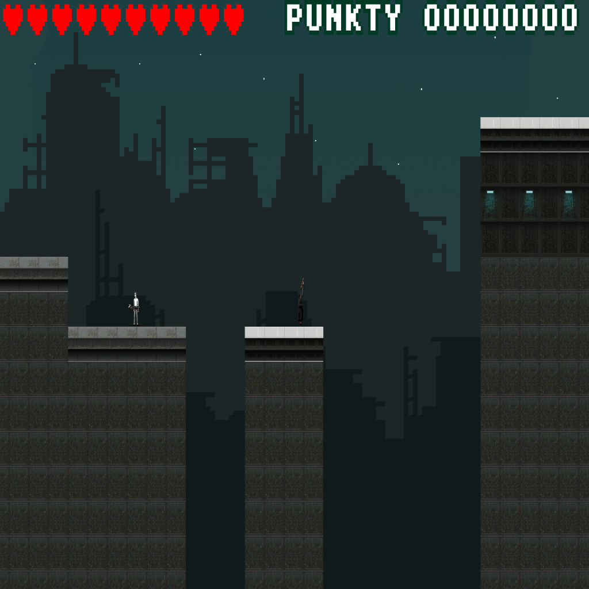
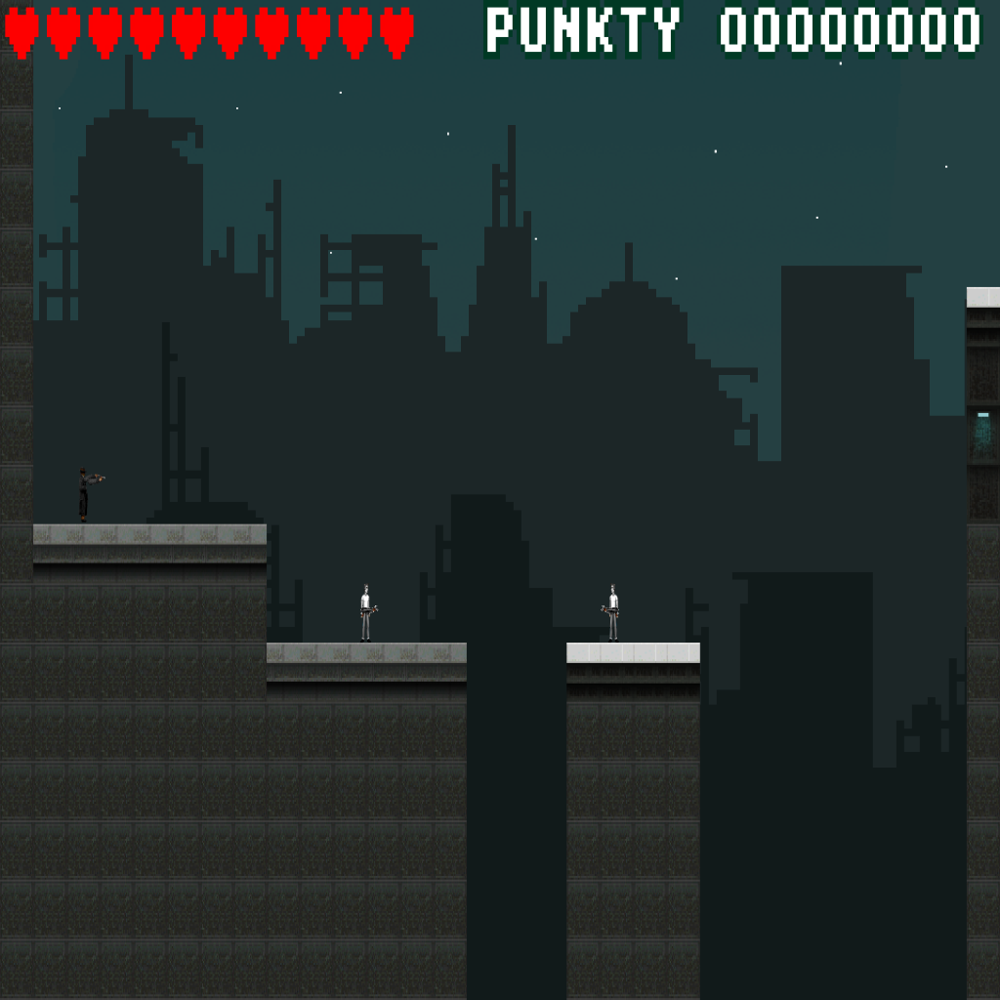

# LWJGL 2D Shooter

A 2D side-scrolling platformer shooter written in Java with [LWJGL 3](https://www.lwjgl.org/) (GLFW + OpenGL) and [JOML](https://github.com/JOML-CI/JOML).
It was made in 2020 as a university course project. The engine is hand-rolled: shaders, sprite rendering, tile maps, collisions, cameras, menus and audio were all written from scratch on top of raw OpenGL.

> Note: the in-game text and the source code comments/Javadoc are in Polish.

## Screenshots

<p align="center">
  
</p>

<p align="center">
  
  
</p>

## Features

- Tile-based levels loaded from PNG images (`levels/levelN/map.png`), with 5 levels
- Player movement with jumping, sprinting and mouse aiming/shooting
- Enemies that shoot back, blood effects and AABB collisions
- Parallax scrolling background
- Main menu, settings, credits, intro and cutscenes
- Save / load system with 4 slots plus quick save, each with a screenshot thumbnail
- High-score board persisted to disk
- In-game screenshots
- Sound effects and background music (Java Sound API)
- Cheat codes

## Controls

| Key | Action |
| --- | --- |
| `A` / `D` | Move left / right |
| `W` / `S` | Move up / down |
| `Space` | Jump |
| `Left Shift` | Sprint |
| Mouse | Aim |
| Left mouse button | Shoot |
| `E` | Show speech bubble |
| `Esc` | Open / close menu |
| `F5` | Quick save |
| `F8` | Quick load |
| `F9` | Take a screenshot (saved to `screenshots/`) |

### Cheat codes

Type these during gameplay:

| Code | Effect |
| --- | --- |
| `AEZAKMI` | +90,000 points |
| `HESOYAM` | Set lives to 10 |
| `GODMODE` | Toggle god mode |
| `KILLEMALL` | Kill all enemies |
| `NEXTLVL` | Skip to the next level |
| `IREGRETNOTHING` | Game over |

## Requirements

- JDK 11 or newer
- Windows (the bundled LWJGL natives in `libs/` are Windows-only; for Linux/macOS download the matching `lwjgl*-natives-*.jar` files for LWJGL 3.2.3 from [lwjgl.org](https://www.lwjgl.org/customize))
- A GPU with OpenGL 3.0+ support

## Running

The game loads textures, levels, audio and saves relative to the working directory, so it must be run from the repository root.

### IntelliJ IDEA

Open the folder as a project, set the project SDK to JDK 11+, and run `gra.game.Main`.

### Command line

```sh
# compile
javac -encoding UTF-8 -cp "libs/*" -d out $(find src -name "*.java")
cp -r src/shaders out/

# run (from the repository root)
java -cp "out;libs/*" gra.game.Main     # Windows
java -cp "out:libs/*" gra.game.Main     # Linux/macOS
```

## Project structure

```
src/gra/
├── collision/   AABB and collision detection
├── entity/      Player, enemies, bullets, blood, transforms
├── game/        Main class and game loop
├── gui/         Menus, buttons, HUD bars, intro, cutscenes, credits, scoreboard
├── io/          Window, input, audio, timer, screenshots, cheat codes
├── render/      Shaders, textures, models, sprite sheets, animation, camera
├── scores/      High-score persistence
└── world/       World, tiles, tile renderer, background layers, save system
src/shaders/     GLSL vertex/fragment shaders
textures/        Sprites, tiles, fonts and GUI sheets
levels/          Level maps (each pixel color encodes a tile/entity)
audio/           Sound effects and music
saves/           Save slots and their thumbnails
libs/            LWJGL 3.2.3 (core, GLFW, OpenGL) and JOML 1.9.22
```

## Javadoc

Generate the API docs with:

```sh
javadoc -encoding UTF-8 -charset UTF-8 -docencoding UTF-8 -private -cp "libs/*" -d docs -sourcepath src -subpackages gra
```
